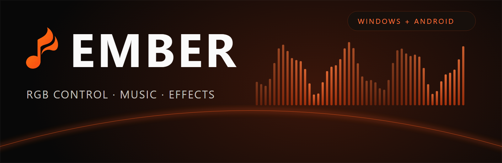
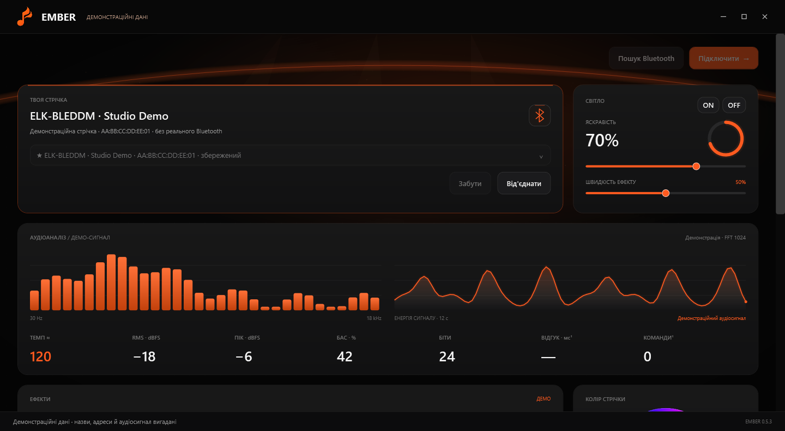
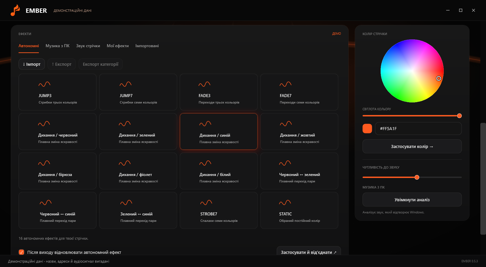
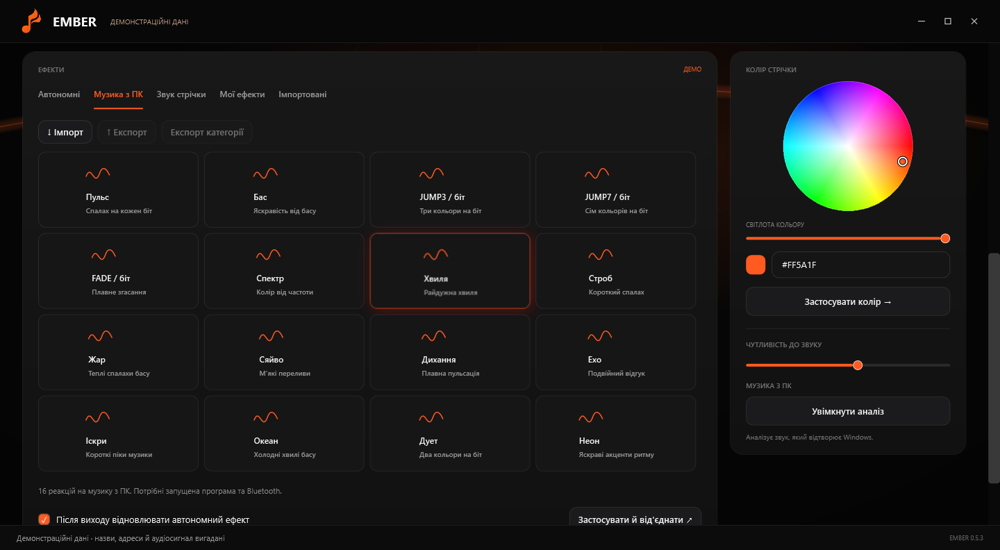
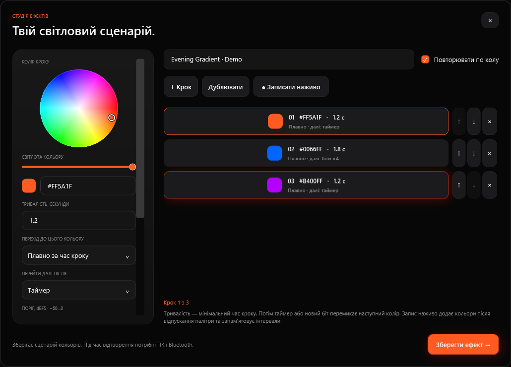
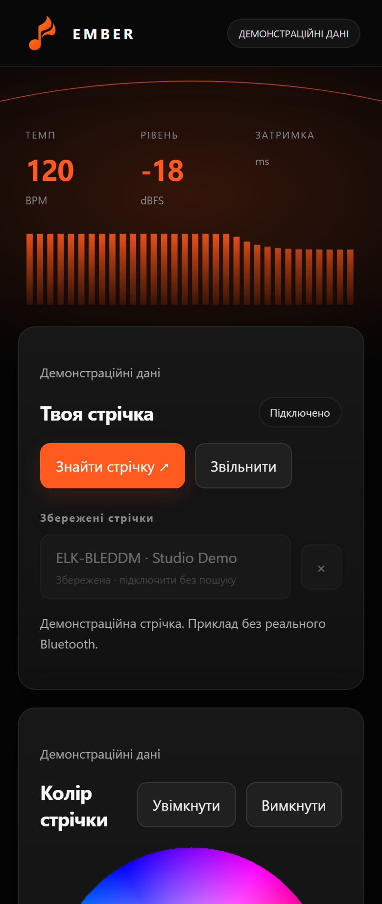
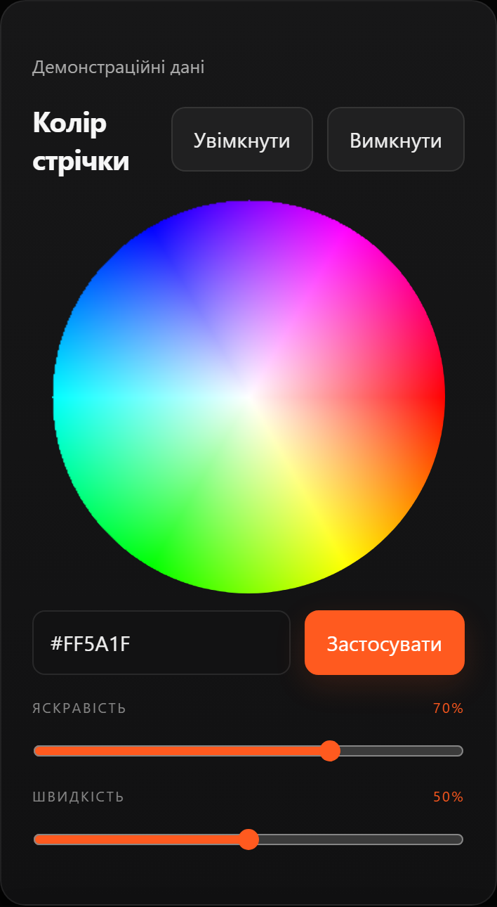
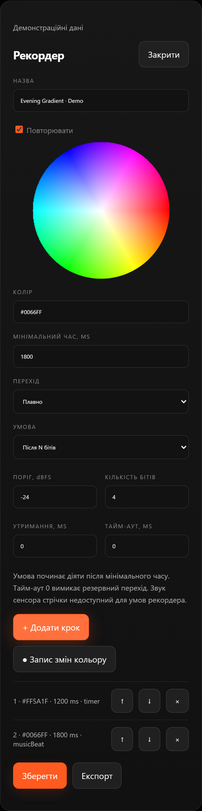

**English** · [Українською](README_UK.md)

Ember controls compatible Bluetooth Low Energy RGB light strips from Windows or Android. Choose a color, use the controller's built-in effects, sync colors with playback audio, or create your own timed sequences.

**[Download for Windows](https://github.com/ThunderBoldX/Ember/releases/download/v0.5.3/Ember-Windows-v0.5.3-Setup.exe)** · **[Download Android APK](https://github.com/ThunderBoldX/Ember/releases/download/v0.5.3/Ember-Android-v0.5.3.apk)** · [All releases and checksums](https://github.com/ThunderBoldX/Ember/releases) · [Installation guide](docs/INSTALL.md)



<details>
<summary>More screenshots: effects, music, custom sequences and Android</summary>





<p>



</p>

Windows images render the real WPF windows. Android images render the actual APK web interface in Chromium, rather than a physical phone. Device names, addresses and audio data are fictional and labelled **demonstration data**. They are not hardware measurements. [Screenshot generation](docs/DEVELOPMENT.md#screenshots).

</details>

## Who it is for

Ember is for people with a supported BLE RGB controller who want a desktop or phone interface for room lighting, playback-reactive colors and reusable sequences. It needs no Ember account. One controller can be connected at a time; saved devices make it easier to switch between strips.

## What works

- RGB color wheel, HEX color input, brightness, power and effect-speed controls, within each controller's capabilities.
- 16 autonomous effect presets and 16 software music effects. Firmware mode names and behavior can vary.
- 16 strip-microphone presets: **8 native modes with 2 sensitivity settings each**, not 16 new firmware algorithms. A microphone-equipped compatible controller is required.
- Playback audio analysis: Windows output loopback, or Android playback capture with permission. This is different from the microphone inside the strip controller.
- Custom color sequences: cuts/fades, minimum durations, repeat, pause and manual advance; beat count, bass/peak/level thresholds, sustained silence and timeout conditions.
- Local recording of color changes, plus import/export of Ember v1/v2 JSON effect packs between Windows and Android.
- Up to 30 saved controllers, direct reconnection, automatic profile detection and connection diagnostics.

These are implemented features. There is no published roadmap promising support for every controller or another operating system.

## Requirements and compatibility

| Platform | Requirements |
| --- | --- |
| Windows | x64 PC with Bluetooth LE. Windows 11 is the primary desktop target. Setup includes the .NET 10 desktop runtime; no SDK is needed to use it. Windows PowerShell 5.1 and the Windows Bluetooth stack are used by the BLE bridge. |
| Android | Android 8.0/API 26 or newer, Bluetooth LE and an up-to-date compatible Android System WebView. Phone-playback music capture requires Android 10/API 29 or newer. |
| Other systems | No macOS, Linux desktop or iOS application is provided. Windows ARM64/x86 packages are not provided. |

Windows 10 has not been separately validated. Its supported editions also depend on Microsoft's [.NET/Windows support matrix](https://learn.microsoft.com/en-us/dotnet/core/install/windows#supported-versions); do not assume every Windows 10 installation is supported.

| Controller family | Recognized GATT pairs | Notes |
| --- | --- | --- |
| ELK-BLEDOB | FFF0/FFF3, FFE0/FFE1 | RGB and native effects; microphone support depends on hardware/firmware. |
| MELK | FFF0/FFF3, FFE0/FFE1 | Mode IDs vary; diagnostic mapping is available. |
| ELK-BLEDOM / BLEDDM | FFF0/FFF3, FFE5/FFE9, FFE0/FFE1 | Automatic family detection; native microphone modes depend on firmware. |
| Triones / HappyLighting | FFD5/FFD9 | RGB, power, mapped effects, software music and sequences; no supported native microphone mode. |

This is protocol-family support, not a tested model-by-model certification list. Unknown protocols are rejected. RGBW white-channel control and individually addressed RGBIC pixels are not implemented.

<a id="install"></a>
## Install and connect

### Windows

1. Download `Ember-Windows-v0.5.3-Setup.exe` from the links above or the [v0.5.3 release](https://github.com/ThunderBoldX/Ember/releases/tag/v0.5.3).
2. Run Setup. It installs for your current user, includes the runtime and offers desktop/Start menu shortcuts. No folders need to be unpacked manually.
3. Power the strip, enable Bluetooth, then open Ember. Choose **Пошук Bluetooth** (Bluetooth search), select the strip and press **Підключити** (Connect).
4. Choose a color or an effect. A successful connection saves the controller for next time.

The interface is currently Ukrainian. The installer is not Authenticode-signed; Windows may identify an unknown publisher. Verify the release source and SHA-256 checksum before running it.

### Android

1. Download `Ember-Android-v0.5.3.apk` from this repository's release.
2. Open the APK and allow installation from your browser/file manager when Android asks. This is a direct APK, not a Play Store listing.
3. Grant Bluetooth/Nearby devices permission. On Android 8–11, BLE scanning also uses the location permission required by those Android versions.
4. Power the strip, tap **Знайти стрічку** (Find strip) and choose it. For music, select **Музика телефона**, grant playback-capture permission and choose an effect.

Release APKs use the same signing certificate as earlier Ember builds from this project. Install over the previous release to keep local data. A build signed with your own key cannot replace that installation without uninstalling it first.

## Three common workflows

**A fixed color or built-in effect:** connect, choose a color or the **Автономні** tab, then adjust brightness/speed. Switching commands are paced for the controller; repeating the click should not be required. Native controller effects can run independently, but behavior after disconnect/power loss is firmware-dependent.

**Music:** on Windows choose **Музика з ПК** and enable analysis while playing audio through Windows. On Android allow playback capture and choose **Музика телефона**. Keep the application/service and Bluetooth connection running. Some apps and protected audio sources refuse capture.

**Your own sequence:** open **Мої ефекти**, create/record colors, choose timing and transition conditions, and save. Import/export JSON packs to move effects between platforms. Playback of custom sequences needs the app and Bluetooth. A strip's native microphone signal cannot be used as a custom-sequence input.

## Troubleshooting

| Problem | What to check |
| --- | --- |
| `Unreachable`, timeout or strip not found | Check the strip's physical power first. Move closer, release it from another app/phone, then retry. A saved name does not prove that the strip is powered or nearby. |
| Device connects but is unsupported | Compare its name/GATT protocol with the table above. Do not assume that any BLE device is a compatible RGB controller. |
| Native effect looks different | Firmware IDs differ. Windows diagnostics let you test mode IDs and adjust the JUMP/FADE mapping. |
| Music does nothing | Enable analysis/capture, play an allowed audio source and select a software music effect. Controller-microphone mode listens near the strip, not to Windows/phone playback. |
| Android cannot capture audio | Requires Android 10+, recording/capture consent and a source that permits playback capture. Bluetooth permission alone is insufficient. |
| Android stops in the background | Keep Ember's foreground notification active. Battery/background restrictions vary by phone. |
| APK cannot update an existing install | Check that it is an Ember release signed with the same certificate; separately signed development builds are different installations. Export your effects before uninstalling anything. |

## Limits and verification

- Only one active strip connection per application instance. Other phones/apps can hold a controller connection.
- The latency counter measures software GATT-write time, **not** end-to-end light response. Scheduling intervals are not a hardware latency benchmark.
- Some microphone modes, native brightness behavior and disconnect persistence vary by controller firmware. Triones native-effect brightness is firmware-defined; RGB brightness is scaled in software.
- The v0.5.3 code passed Windows unit checks, real WPF-button tests against a simulated controller, Android core/queue tests and browser UI checks. The Windows package was extracted and launched/closed. A physical strip and a physical Android device were **not** used to validate this publication build. [Validation details](docs/VALIDATION.md).
- Settings/effects are local. The Windows installer currently has no uninstall wizard: close Ember and remove its version folder/shortcuts if needed. [Paths and removal](docs/INSTALL.md#data-and-removal).

## Run and build from source

Clone the repository. Use Windows with **.NET 10 SDK** for the desktop app, and **JDK 17+**, Android SDK platform 35/build-tools 35.0.0 for Android. Node.js 22 and Python 3.10+ support the test/documentation tools.

```powershell
git clone https://github.com/ThunderBoldX/Ember.git
cd Ember
./windows/Build.ps1
dotnet run --project windows/Ember/Ember.csproj -c Release
```

Build an Android compile-check APK without publishing a private key:

```powershell
./android/Build-Android.ps1 -SdkRoot $env:ANDROID_SDK_ROOT -Unsigned
```

Unsigned APKs are for compile checks and cannot be installed until signed. [Full development guide](docs/DEVELOPMENT.md) covers Windows Setup packaging, private Android signing, tests, screenshots and the effect format.

## License and acknowledgements

Ember's own source is licensed under [MIT](LICENSE), copyright 2026 ThunderBoldX. Third-party software and protocol references retain their own notices. See [THIRD_PARTY_NOTICES.md](THIRD_PARTY_NOTICES.md), including the licenses shipped with the Windows runtime.
