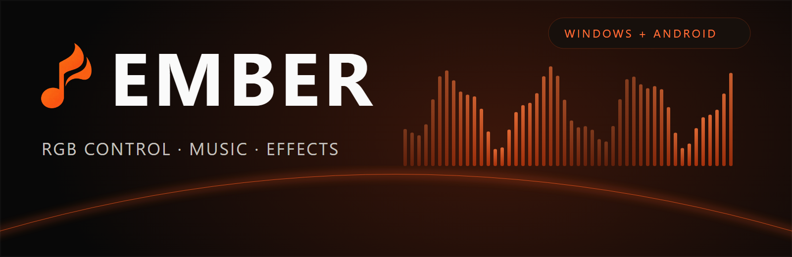
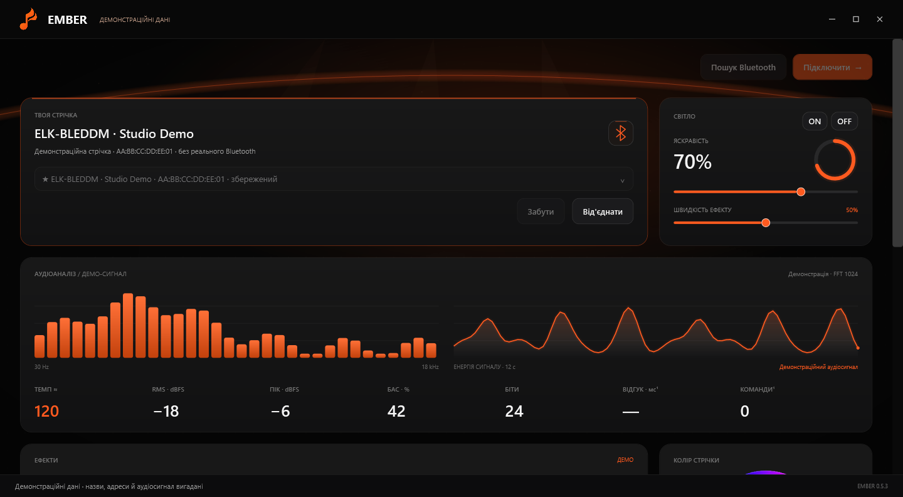
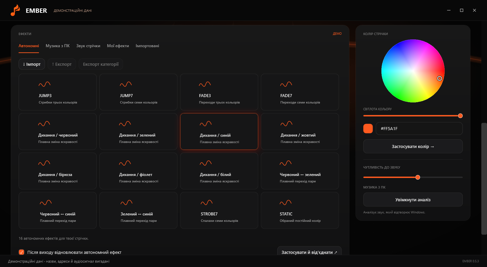
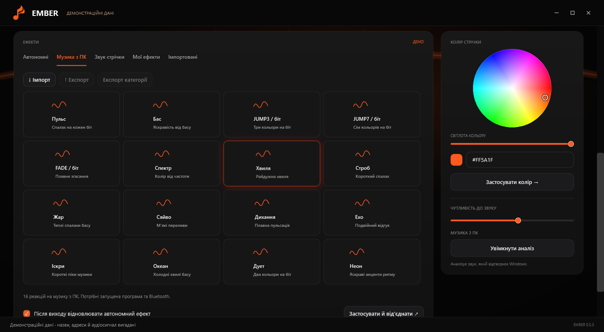
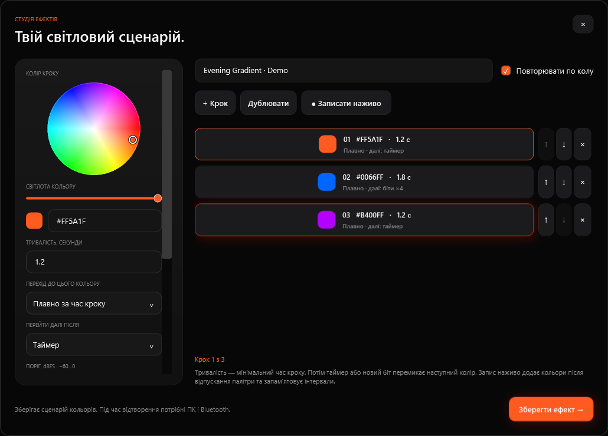
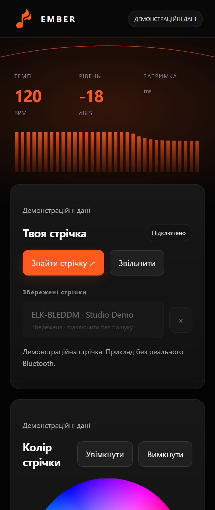
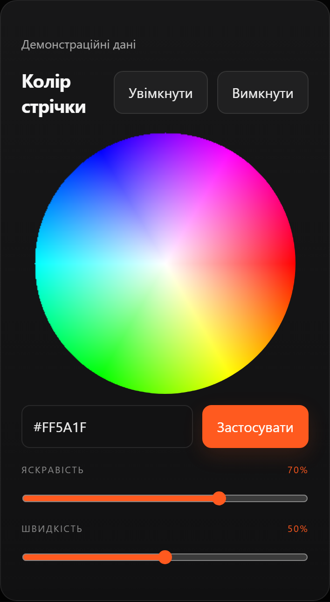
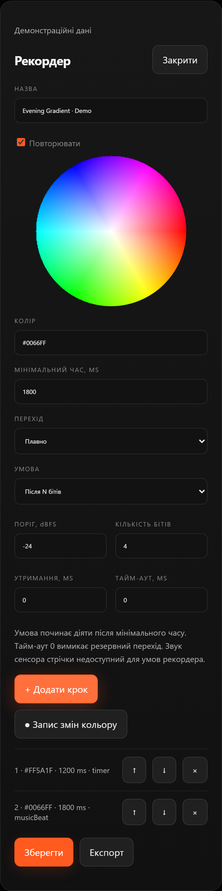

**Українською** · [English](README.md)

Ember керує сумісними RGB-стрічками через Bluetooth Low Energy на Windows і Android. Вибирай колір, запускай вбудовані ефекти контролера, синхронізуй світло з відтворюваною музикою або створюй власні послідовності.

**[Завантажити для Windows](https://github.com/ThunderBoldX/Ember/releases/download/v0.5.3/Ember-Windows-v0.5.3-Setup.exe)** · **[Завантажити Android APK](https://github.com/ThunderBoldX/Ember/releases/download/v0.5.3/Ember-Android-v0.5.3.apk)** · [Релізи й контрольні суми](https://github.com/ThunderBoldX/Ember/releases) · [Інструкція встановлення](docs/INSTALL.md)



<details>
<summary>Більше скриншотів: ефекти, музика, редактор і Android</summary>





<p>



</p>

Windows — рендер справжніх WPF-вікон. Android — справжній вебінтерфейс APK, відрендерений у Chromium, без фізичного телефона. Назви стрічок, адреси й аудіосигнал вигадані та позначені як **демонстраційні дані**. Це не результати вимірювань на обладнанні. [Як створено скриншоти](docs/DEVELOPMENT.md#screenshots).

</details>

## Для кого ця програма

Для власників підтримуваних BLE RGB-контролерів, яким потрібне керування кімнатним світлом із ПК або телефона, реакції на музику та збережені послідовності кольорів. Обліковий запис Ember не потрібний. Одночасно підключається одна стрічка; збережений список спрощує перемикання між пристроями.

## Готові можливості

- Колірне колесо, введення HEX, яскравість, живлення та швидкість ефекту в межах можливостей контролера.
- 16 пресетів автономних ефектів і 16 програмних реакцій на музику. Назви та поведінка апаратних режимів залежать від прошивки.
- 16 пресетів «Звуку стрічки»: **8 нативних режимів із двома рівнями чутливості**, а не 16 нових алгоритмів прошивки. Потрібен сумісний контролер із мікрофоном.
- Аналіз звуку, який відтворює Windows, або захоплення дозволеного аудіо Android. Це окремий режим від мікрофона всередині контролера стрічки.
- Власні послідовності: миттєві/плавні переходи, мінімальна тривалість, повторення, пауза й ручний перехід; кількість бітів, пороги басу/піку/рівня, тривала тиша й тайм-аут.
- Запис змін кольору та імпорт/експорт JSON-пакетів Ember v1/v2 між ПК і телефоном.
- До 30 збережених контролерів, підключення без повного пошуку, автоматичний вибір профілю та діагностика.

Це реалізовані функції. Опублікованих обіцянок підтримати всі контролери або інші операційні системи немає.

## Вимоги та сумісність

| Платформа | Вимоги |
| --- | --- |
| Windows | ПК x64 із Bluetooth LE. Основна ціль — Windows 11. Setup містить .NET 10 Desktop Runtime; SDK для використання не потрібний. Bluetooth-модуль використовує вбудований Windows PowerShell 5.1 та Bluetooth-стек Windows. |
| Android | Android 8.0/API 26 або новіший, Bluetooth LE й актуальний сумісний Android System WebView. Захоплення музики телефона потребує Android 10/API 29 або новішого. |
| Інші системи | Версій для macOS, Linux та iOS немає. Пакети Windows ARM64/x86 не надаються. |

Windows 10 окремо не перевірявся. Підтримувані редакції також залежать від [матриці сумісності .NET і Windows від Microsoft](https://learn.microsoft.com/en-us/dotnet/core/install/windows#supported-versions); не кожна інсталяція Windows 10 автоматично підтримується.

| Сім’я контролера | Розпізнавані GATT-пари | Примітки |
| --- | --- | --- |
| ELK-BLEDOB | FFF0/FFF3, FFE0/FFE1 | RGB та апаратні ефекти; мікрофон залежить від обладнання/прошивки. |
| MELK | FFF0/FFF3, FFE0/FFE1 | ID режимів відрізняються; доступне налаштування відповідностей у діагностиці. |
| ELK-BLEDOM / BLEDDM | FFF0/FFF3, FFE5/FFE9, FFE0/FFE1 | Профіль визначається автоматично; звукові режими залежать від прошивки. |
| Triones / HappyLighting | FFD5/FFD9 | RGB, живлення, зіставлені ефекти, програмна музика та послідовності; нативний мікрофон не підтримується. |

Це підтримка сімей протоколів, а не список сертифікованих моделей. Невідомі протоколи відхиляються. Окремий білий канал RGBW та індивідуальні пікселі RGBIC не реалізовані.

<a id="install"></a>
## Встановлення та перше підключення

### Windows

1. Завантаж `Ember-Windows-v0.5.3-Setup.exe` за посиланням угорі або з [релізу v0.5.3](https://github.com/ThunderBoldX/Ember/releases/tag/v0.5.3).
2. Запусти Setup. Він встановлює програму для поточного користувача, містить runtime та пропонує створити ярлики. Розпаковувати папки вручну не потрібно.
3. Подай живлення на стрічку, увімкни Bluetooth і відкрий Ember. Натисни **Пошук Bluetooth**, вибери стрічку та натисни **Підключити**.
4. Вибери колір або ефект. Після успішного підключення контролер збережеться у списку.

Інтерфейс наразі українською. Інсталятор не має Authenticode-підпису; Windows може показати невідомого видавця. Перед запуском перевір джерело релізу й SHA-256 файла.

### Android

1. Завантаж `Ember-Android-v0.5.3.apk` із релізу цього репозиторію.
2. Відкрий APK та дозволь встановлення з браузера/файлового менеджера, коли Android запитає. Це пряме встановлення APK, не Google Play.
3. Надай дозвіл Bluetooth/«Пристрої поблизу». На Android 8–11 для BLE-пошуку використовується також дозвіл геолокації, якого вимагають ці версії Android.
4. Увімкни живлення стрічки, натисни **Знайти стрічку** й вибери пристрій. Для музики відкрий **Музика телефона**, дозволь захоплення аудіо та вибери ефект.

Релізні APK підписані тим самим сертифікатом, що й попередні збірки Ember цього проєкту. Встановлення поверх попередньої версії зберігає локальні дані. Збірка з власним ключем не замінить її без попереднього видалення.

## Основні сценарії

**Постійний колір або апаратний ефект:** підключись, вибери колір або вкладку **Автономні**, налаштуй яскравість/швидкість. Команди перемикання мають паузу для обробки контролером; повторний клік не повинен бути потрібний. Вбудовані ефекти виконує контролер, але поведінка після відключення чи втрати живлення залежить від прошивки.

**Музика:** на Windows вибери **Музика з ПК** та увімкни аналіз під час відтворення звуку Windows. На Android дозволь захоплення аудіо й вибери **Музика телефона**. Програма/служба та Bluetooth мають працювати. Деякі програми й захищені джерела забороняють захоплення.

**Власна послідовність:** у **Мої ефекти** створи або запиши кольори, задай тривалість та умови переходів і збережи. Перенось їх між платформами через JSON-пакети. Для відтворення потрібні програма та Bluetooth. Сигнал нативного мікрофона стрічки не є джерелом умов власної послідовності.

## Типові проблеми

| Проблема | Що перевірити |
| --- | --- |
| `Unreachable`, тайм-аут або стрічку не знайдено | Спочатку перевір фізичне живлення. Підійди ближче, звільни стрічку від іншої програми/телефона та повтори. Збережена назва не доводить, що пристрій увімкнений або поруч. |
| Пристрій підключається, але не підтримується | Зістав його назву/GATT-протокол із таблицею. Не кожен BLE-пристрій є сумісним RGB-контролером. |
| Апаратний ефект виглядає інакше | ID залежать від прошивки. Діагностика Windows дає перевірити ID та налаштувати відповідності JUMP/FADE. |
| Музика не змінює світло | Увімкни аналіз/захоплення, запусти дозволене джерело та вибери програмний музичний ефект. «Звук стрічки» слухає біля контролера, а не звук ПК/телефона. |
| Android не захоплює аудіо | Потрібні Android 10+, згода на запис/захоплення та джерело, що це дозволяє. Самого дозволу Bluetooth недостатньо. |
| Android зупиняється у фоні | Залиш активним сповіщення служби Ember. Обмеження батареї й фонових програм залежать від телефона. |
| APK не встановлюється поверх старого | Перевір, що це реліз Ember з тим самим сертифікатом. Власноруч підписані збірки — інші інсталяції. Перед видаленням експортуй свої ефекти. |

## Обмеження та перевірки

- Одна активна стрічка на екземпляр програми. Інша програма/телефон може утримувати контролер.
- Лічильник затримки вимірює час програмного GATT-запису, **а не** повний шлях до світла. Інтервали планувальника не є виміряною затримкою обладнання.
- Звукові режими, нативна яскравість і поведінка після відключення залежать від прошивки. Яскравість апаратних ефектів Triones визначає прошивка; RGB масштабується програмно.
- Код v0.5.3 пройшов тести Windows, перевірку справжніх WPF-кнопок на моделі контролера, Android-тести ядра/черги та браузерного інтерфейсу. Windows-пакет розпаковано й перевірено запуск/закриття. Фізичну стрічку та фізичний Android-пристрій для перевірки цієї публікаційної збірки **не використовували**. [Докладний звіт](docs/VALIDATION.md).
- Налаштування й ефекти зберігаються локально. Windows-інсталятор поки не має майстра видалення: закрий Ember і за потреби видали папку версії та ярлики. [Шляхи й видалення](docs/INSTALL.md#data-and-removal).

## Запуск і збірка з коду

Для Windows потрібні Windows і **.NET 10 SDK**. Для Android — **JDK 17+**, Android SDK platform 35/build-tools 35.0.0. Node.js 22 та Python 3.10+ потрібні для інструментів перевірки й документації.

```powershell
git clone https://github.com/ThunderBoldX/Ember.git
cd Ember
./windows/Build.ps1
dotnet run --project windows/Ember/Ember.csproj -c Release
```

Перевірочна збірка Android без публікації приватного ключа:

```powershell
./android/Build-Android.ps1 -SdkRoot $env:ANDROID_SDK_ROOT -Unsigned
```

Непідписаний APK потрібний для перевірки компіляції; встановлення потребує підпису. [Інструкція для розробників](docs/DEVELOPMENT.md) описує Windows Setup, приватний підпис Android, тести, скриншоти та формат ефектів.

## Ліцензія та подяки

Власний код Ember поширюється під [MIT](LICENSE), copyright 2026 ThunderBoldX. Сторонні компоненти й джерела протоколів зберігають свої повідомлення. Дивись [THIRD_PARTY_NOTICES.md](THIRD_PARTY_NOTICES.md), зокрема ліцензії runtime у Windows-пакеті.
